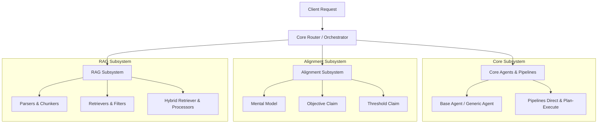

# System Architecture Overview

**Auraflux-Core** is structured into distinct, modular subsystems designed for agentic workflows, alignment verification, and retrieval-augmented generation (RAG).

## High-Level Architecture Diagram

## Subsystem Breakdown

1. **`src/auraflux_core/core/`**: Provides foundational agent classes, client management handlers (Gemini, OpenAI, vLLM), orchestration routers, adapters, and messaging formatters.
2. **`src/auraflux_core/alignment/`**: Implements specialized alignment strategies and verification pipelines including mental models, objective claims, and threshold claims.
3. **`src/auraflux_core/rag/`**: Contains document parsers, dynamic chunkers, semantic/static filters, and hybrid retrievers for robust knowledge retrieval.
