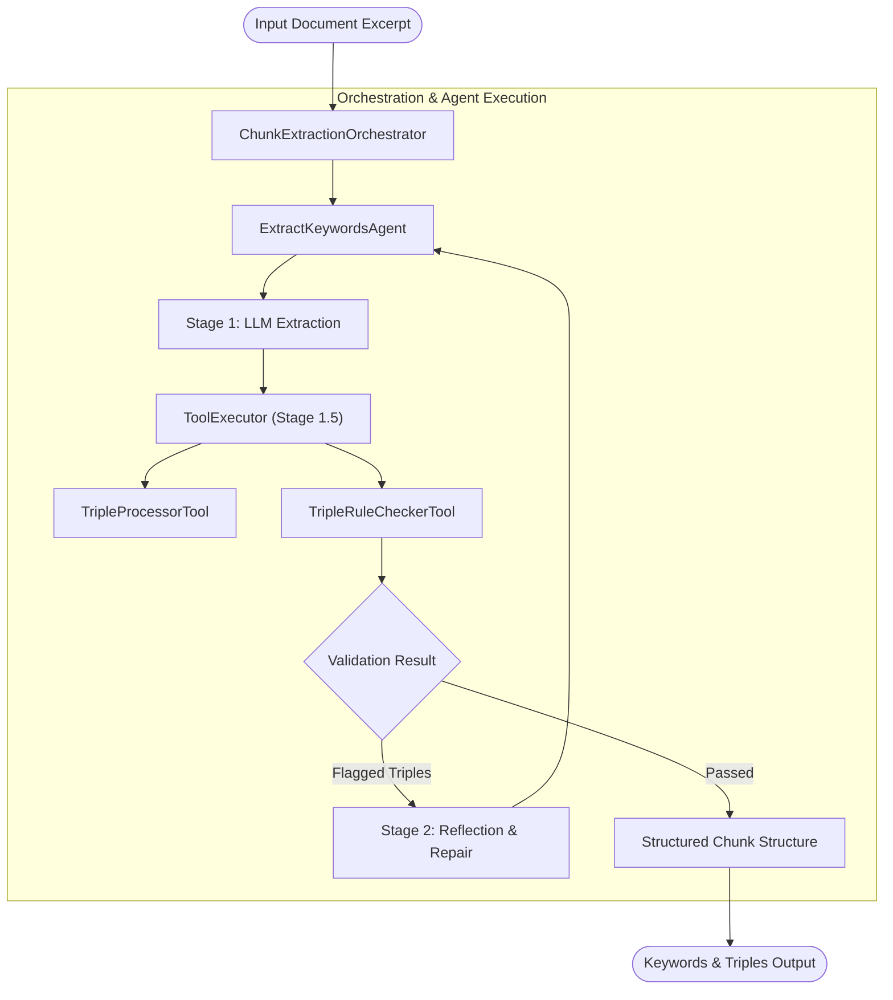

# Orchestrator & ExtractKeywordsAgent Chunk Extraction Example (`orchestrator-keywords-example.md`)

This document demonstrates how to combine [`BaseOrchestrator`](src/auraflux_core/core/orchestrators/base.py:16) and [`ExtractKeywordsAgent`](src/auraflux_core/rag/agents/keywords_extractor.py:14) within the **Auraflux-Core** framework to extract structured keywords, tags, and semantic triples (Chunk structures) from input texts.

---

## 1. Introduction

In RAG (Retrieval-Augmented Generation) and knowledge graph construction pipelines, unstructured document excerpts often need to be parsed into structured metadata, such as:
- **Keywords / Tags**: Cleaned core topics or tags.
- **Semantic Triples**: Subject-Predicate-Object relationships validated via rule checkers.

This example illustrates how an Orchestrator manages the execution flow of [`ExtractKeywordsAgent`](src/auraflux_core/rag/agents/keywords_extractor.py:14) and its integrated Stage 1.5 post-processing and rule-checking tools (`TripleRuleCheckerTool` and `TripleProcessorTool`).

---

## 2. Architecture Overview



---

## 3. Implementation Code

Below is the complete example showing how to set up the tool registry, configure [`ExtractKeywordsAgent`](src/auraflux_core/rag/agents/keywords_extractor.py:14), and wrap it inside a custom `ChunkExtractionOrchestrator`.

```python
import asyncio
from typing import Any, Dict, List
from auraflux_core.core.orchestrators.base import BaseOrchestrator
from auraflux_core.core.clients.client_manager import ClientManager
from auraflux_core.core.tools.executors.base import ToolExecutor
from auraflux_core.rag.agents.keywords_extractor import ExtractKeywordsAgent
from auraflux_core.rag.tools.triple_processor_tool import TripleProcessorTool
from auraflux_core.rag.tools.triple_rule_checker_tool import TripleRuleCheckerTool

class ChunkExtractionOrchestrator(BaseOrchestrator):
    """
    Orchestrator responsible for coordinating ExtractKeywordsAgent to process
    document excerpts into structured chunk information (keywords, tags, and triples).
    """
    def __init__(
        self,
        extractor_agent: ExtractKeywordsAgent,
        client_manager: ClientManager
    ):
        self.extractor_agent = extractor_agent
        self.client_manager = client_manager

    async def run(self, excerpt_text: str) -> Dict[str, Any]:
        """
        Execute the chunk extraction workflow on the given text excerpt.
        """
        payload = {"excerpt_text": excerpt_text}

        # Invoke the ExtractKeywordsAgent plan-and-execute pipeline
        # (Includes Stage 1 extraction, Stage 1.5 rule checking, and reflection if needed)
        plan_output = await self.extractor_agent.execute(payload=payload)

        return {
            "excerpt_text": excerpt_text,
            "extracted_tags": plan_output.get("tags", []),
            "extracted_triples": plan_output.get("triples", []),
            "accumulated_clean_triples": plan_output.get("_accumulated_clean_triples", [])
        }

async def main():
    # 1. Initialize Client Manager & Tool Executor
    client_manager = ClientManager()
    tool_executor = ToolExecutor()

    # Register required RAG tools for Stage 1.5 post-processing & rule checking
    tool_executor.register("triple_processor", TripleProcessorTool())
    tool_executor.register("triple_rule_checker", TripleRuleCheckerTool())

    # 2. Instantiate ExtractKeywordsAgent with tool executor
    extractor_agent = ExtractKeywordsAgent(
        name="ExtractKeywordsAgent",
        client_manager=client_manager,
        tool_executor=tool_executor
    )

    # 3. Create Orchestrator
    orchestrator = ChunkExtractionOrchestrator(
        extractor_agent=extractor_agent,
        client_manager=client_manager
    )

    # 4. Run sample text excerpt extraction
    sample_text = (
        "Auraflux-Core is an advanced agentic framework designed for building robust RAG systems. "
        "It supports multi-path hybrid retrieval, semantic filtering, and structured triple extraction."
    )

    result = await orchestrator.run(excerpt_text=sample_text)
    print("Extraction Result:")
    print(result)

if __name__ == "__main__":
    asyncio.run(main())
```

---

## 4. Key Design Highlights

1. **Dual-Stage Validation**: [`ExtractKeywordsAgent`](src/auraflux_core/rag/agents/keywords_extractor.py:14) leverages `PlanAndExecuteHandler` to automatically inspect extracted triples against text context via `TripleRuleCheckerTool`.
2. **Modular Orchestration**: `ChunkExtractionOrchestrator` cleanly encapsulates agent execution details, providing a reusable entry point for document preprocessing and knowledge graph generation pipelines.
