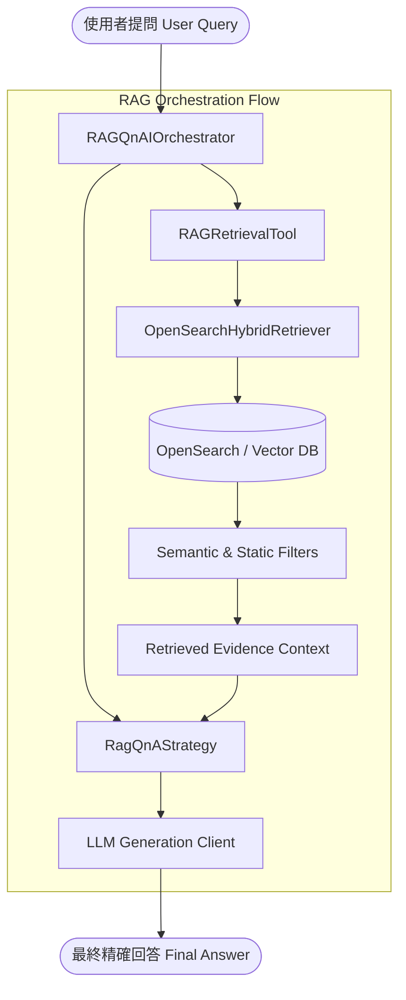

# 問答 RAG Orchestrator 範例教學 (`rag-orchestrator-example.md`)

本文件旨在介紹如何結合 **Auraflux-Core** 的 `core` 與 `rag` 模組，建構一套完整的「問答 RAG Orchestrator」範例，實現從知識檢索到智能問答的自動化流程。

---

## 1. 簡介 (Introduction)

在複雜的企業級應用中，單純的 LLM 對話往往受限於知識的時效性與幻覺（Hallucination）問題。透過 **RAG (Retrieval-Augmented Generation) Orchestrator**，系統能夠在回答問題前自動化執行：
- 關鍵字萃取與查詢優化
- 多路混合檢索（Hybrid Retrieval）
- 檢索結果過濾與排序
- 結合上下文進行精確的 LLM 生成與驗證

本範例將帶領開發者一步步實作包含 `RAGRetrievalTool`、`RagQnAStrategy` 以及 `RAGQnAIOrchestrator` 的完整架構。

---

## 2. 架構概覽 (Architecture Overview)

以下為問答 RAG Orchestrator 的核心執行流程與模組互動架構：



---

## 3. 實作步驟 (Implementation Steps)

以下將依序介紹三大核心元件的程式碼實作：

### 步驟一：實作檢索工具 `RAGRetrievalTool`
`RAGRetrievalTool` 負責封裝底層的混合檢索器與過濾器，將使用者的提問轉換為檢索請求並取得對應的知識片段（Evidence）。

```python
from typing import Any, Dict, List
from auraflux_core.core.tools.base_tool import BaseTool
from auraflux_core.rag.tools.hybrid_retriever import HybridRetrieverTool

class RAGRetrievalTool(BaseTool):
    """
    負責封裝檢索邏輯的 RAG 檢索工具。
    """
    def __init__(self, hybrid_retriever_tool: HybridRetrieverTool):
        self.hybrid_retriever_tool = hybrid_retriever_tool

    async def execute(self, query: str, top_k: int = 5) -> List[Dict[str, Any]]:
        """
        執行檢索並回傳相關文件片段。
        """
        response = await self.hybrid_retriever_tool.execute(query=query, top_k=top_k)
        return response.get("results", [])
```

### 步驟二：實作策略核心 `RagQnAStrategy`
`RagQnAStrategy` 定義了檢索後資料的組合與提示詞組裝邏輯，讓 LLM 能夠依據檢索到的事實回答問題。

```python
from typing import Any, Dict, List
from auraflux_core.core.orchestrators.strategies.base import OrchestrationStrategy

class RagQnAStrategy(OrchestrationStrategy):
    """
    問答 RAG 的執行策略，負責組合上下文與產生 Prompt。
    """
    def build_prompt(self, query: str, retrieved_chunks: List[Dict[str, Any]]) -> str:
        context_str = "\n\n".join([f"- {chunk.get('content', '')}" for chunk in retrieved_chunks])
        prompt = f"""請基於以下提供的參考資料，回答使用者的問題。若資料不足以回答，請誠實告知。

[參考資料]
{context_str}

[使用者問題]
{query}
"""
        return prompt
```

### 步驟三：整合 Orchestrator `RAGQnAIOrchestrator`
透過 `RAGQnAIOrchestrator` 串接工具與策略，統一調度整個問答生命週期。

```python
from typing import Any, Dict
from auraflux_core.core.orchestrators.base import BaseOrchestrator
from auraflux_core.core.clients.client_manager import ClientManager

class RAGQnAIOrchestrator(BaseOrchestrator):
    """
    RAG 問答總機，協同檢索與生成策略。
    """
    def __init__(self, retrieval_tool: RAGRetrievalTool, strategy: RagQnAStrategy, client_manager: ClientManager):
        self.retrieval_tool = retrieval_tool
        self.strategy = strategy
        self.client_manager = client_manager

    async def run(self, query: str) -> Dict[str, Any]:
        # 1. 執行檢索
        chunks = await self.retrieval_tool.execute(query=query)

        # 2. 組合策略 Prompt
        prompt = self.strategy.build_prompt(query=query, retrieved_chunks=chunks)

        # 3. 調用 LLM 客戶端生成回應
        handler = self.client_manager.get_handler("gemini")
        response = await handler.generate_async(prompt)

        return {
            "query": query,
            "retrieved_count": len(chunks),
            "answer": response
        }
```

---

## 4. 注意事項 (Notes)

1. **設計彈性**：本範例展示了典型的多層次架構（Tools -> Strategies -> Orchestrators）。開發者可以隨時抽換底層的檢索工具（如從 OpenSearch 換成向量資料庫），或替換不同的 LLM 供應商（Gemini / OpenAI / vLLM），而不需要改動整體的編排邏輯。
2. **非同步支援**：所有核心操作皆原生支援 `async/await`，適合高併發的生產環境。
