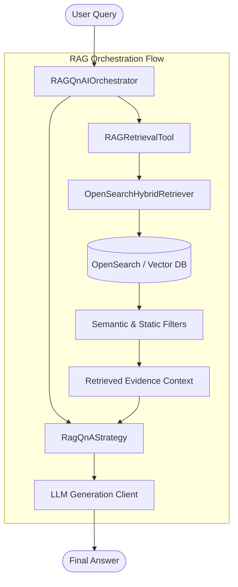

# Q&A RAG Orchestrator Example Tutorial (`rag-orchestrator-example.md`)

This document aims to introduce how to combine the `core` and `rag` modules of **Auraflux-Core** to build a complete "Q&A RAG Orchestrator" example, implementing an automated workflow from knowledge retrieval to intelligent question answering.

---

## 1. Introduction

In complex enterprise-level applications, simple LLM conversations are often constrained by the timeliness of knowledge and hallucination issues. Through the **RAG (Retrieval-Augmented Generation) Orchestrator**, the system can automatically execute the following before answering questions:
- Keyword extraction and query optimization
- Multi-path hybrid retrieval (Hybrid Retrieval)
- Retrieval result filtering and ranking
- Precise LLM generation and validation combined with context

This example will guide developers step-by-step through the implementation of a complete architecture containing `RAGRetrievalTool`, `RagQnAStrategy`, and `RAGQnAIOrchestrator`.

---

## 2. Architecture Overview

The following is the core execution flow and module interaction architecture of the Q&A RAG Orchestrator:



---

## 3. Implementation Steps

The code implementation of the three core components will be introduced in sequence below:

### Step 1: Implement the Retrieval Tool `RAGRetrievalTool`
`RAGRetrievalTool` is responsible for encapsulating the underlying hybrid retriever and filters, converting user queries into retrieval requests and obtaining corresponding knowledge fragments (Evidence).

```python
from typing import Any, Dict, List
from auraflux_core.core.tools.base_tool import BaseTool
from auraflux_core.rag.tools.hybrid_retriever import HybridRetrieverTool

class RAGRetrievalTool(BaseTool):
    """
    RAG retrieval tool responsible for encapsulating retrieval logic.
    """
    def __init__(self, hybrid_retriever_tool: HybridRetrieverTool):
        self.hybrid_retriever_tool = hybrid_retriever_tool

    async def execute(self, query: str, top_k: int = 5) -> List[Dict[str, Any]]:
        """
        Execute retrieval and return relevant document chunks.
        """
        response = await self.hybrid_retriever_tool.execute(query=query, top_k=top_k)
        return response.get("results", [])
```

### Step 2: Implement the Strategy Core `RagQnAStrategy`
`RagQnAStrategy` defines the combination of post-retrieval data and prompt assembly logic, allowing the LLM to answer questions based on retrieved facts.

```python
from typing import Any, Dict, List
from auraflux_core.core.orchestrators.strategies.base import OrchestrationStrategy

class RagQnAStrategy(OrchestrationStrategy):
    """
    Execution strategy for Q&A RAG, responsible for combining context and generating prompts.
    """
    def build_prompt(self, query: str, retrieved_chunks: List[Dict[str, Any]]) -> str:
        context_str = "\n\n".join([f"- {chunk.get('content', '')}" for chunk in retrieved_chunks])
        prompt = f"""Please answer the user's question based on the reference materials provided below. If the information is insufficient to answer, please state so honestly.

[Reference Materials]
{context_str}

[User Question]
{query}
"""
        return prompt
```

### Step 3: Integrate the Orchestrator `RAGQnAIOrchestrator`
Connect tools and strategies through `RAGQnAIOrchestrator` to uniformly coordinate the entire Q&A lifecycle.

```python
from typing import Any, Dict
from auraflux_core.core.orchestrators.base import BaseOrchestrator
from auraflux_core.core.clients.client_manager import ClientManager

class RAGQnAIOrchestrator(BaseOrchestrator):
    """
    RAG Q&A orchestrator, coordinating retrieval and generation strategies.
    """
    def __init__(self, retrieval_tool: RAGRetrievalTool, strategy: RagQnAStrategy, client_manager: ClientManager):
        self.retrieval_tool = retrieval_tool
        self.strategy = strategy
        self.client_manager = client_manager

    async def run(self, query: str) -> Dict[str, Any]:
        # 1. Execute retrieval
        chunks = await self.retrieval_tool.execute(query=query)

        # 2. Combine strategy prompt
        prompt = self.strategy.build_prompt(query=query, retrieved_chunks=chunks)

        # 3. Call LLM client to generate response
        handler = self.client_manager.get_handler("gemini")
        response = await handler.generate_async(prompt)

        return {
            "query": query,
            "retrieved_count": len(chunks),
            "answer": response
        }
```

---

## 4. Notes

1. **Design Flexibility**: This example demonstrates a typical multi-layered architecture (Tools -> Strategies -> Orchestrators). Developers can swap out underlying retrieval tools (e.g., from OpenSearch to a vector database) or replace different LLM providers (Gemini / OpenAI / vLLM) at any time without modifying the overall orchestration logic.
2. **Asynchronous Support**: All core operations natively support `async/await`, making them suitable for high-concurrency production environments.
