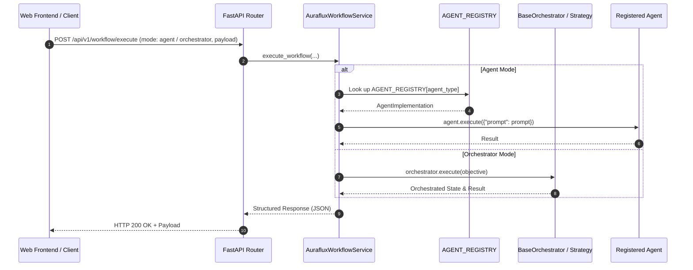

# Backend Integration Tutorial: Sharing Agents & Orchestrators in Web Services

This tutorial guides backend developers on how to cleanly integrate, share, and invoke `Auraflux-Core` **Agents** (via [`src/auraflux_core/agents.py`](../../src/auraflux_core/agents.py) registry and `agent.execute(...)`) and **Orchestrators** (via [`BaseOrchestrator`](../../src/auraflux_core/core/orchestrators/base.py) and [`DualLayerAgenticStrategy`](../../src/auraflux_core/core/orchestrators/strategies/dual_layer_strategy.py)) inside production backend web frameworks (such as FastAPI, Django, or Flask).

---

## 🏗️ 1. Architecture & Design Principles

When embedding Auraflux inside an enterprise backend, adhere to the following architectural best practices:

1. **Centralized Agent Registry (`AGENT_REGISTRY`)**: Use the high-level agent registry exposed in [`src/auraflux_core/agents.py`](../../src/auraflux_core/agents.py) to instantiate pre-configured agents (e.g., `MentalModelAgent`, `ExtractKeywordsAgent`, or `GenericAgent`) dynamically, and execute them via `await agent.execute(payload)`.
2. **Orchestrator & Strategy Pattern**: Use [`BaseOrchestrator`](../../src/auraflux_core/core/orchestrators/base.py) combined with orchestration strategies like [`DualLayerAgenticStrategy`](../../src/auraflux_core/core/orchestrators/strategies/dual_layer_strategy.py), injecting required `agents` and `tools` dictionaries, and execute workflows via `await orchestrator.execute(input_data)`.
3. **Singleton Client & Lifecycle Management**: Initialize [`ClientManager`](../../src/auraflux_core/core/clients/client_manager.py) and configuration settings as application-level Singletons. Avoid re-instantiating LLM providers on every incoming HTTP request.
4. **Service Layer Abstraction**: Encapsulate Agent and Orchestrator execution logic within dedicated Service classes (e.g., `AurafluxWorkflowService`) so that API controllers remain thin and testable.
5. **Asynchronous Execution (`async/await`)**: Leverage Python's asynchronous model for non-blocking LLM inference and tool execution.

---

## 📐 2. System Architecture Diagram



---

## 💻 3. Implementation Example (FastAPI Service Layer)

Below is a complete, production-ready example demonstrating how to wrap Auraflux Agents (`agent.execute(...)`) and Orchestrators (`orchestrator.execute(...)`) into a reusable service and expose them via FastAPI.

### Step 3.1: Create `app/services/auraflux_workflow_service.py`

```python
from typing import Dict, Any, Optional
from auraflux_core.core.configs.settings import AurafluxSettings
from auraflux_core.core.clients.client_manager import ClientManager
from auraflux_core.core.schemas.clients import ProviderConfig
from auraflux_core.agents import AGENT_REGISTRY
from auraflux_core.core.orchestrators.base import BaseOrchestrator
from auraflux_core.core.orchestrators.strategies.dual_layer_strategy import DualLayerAgenticStrategy

class AurafluxWorkflowService:
    _instance: Optional["AurafluxWorkflowService"] = None

    def __init__(self):
        # 1. Initialize settings & ClientManager as singletons
        self.settings = AurafluxSettings()
        self.client_manager = ClientManager(self.settings)

    @classmethod
    def get_instance(cls) -> "AurafluxWorkflowService":
        if cls._instance is None:
            cls._instance = cls()
        return cls._instance

    async def execute_agent(self, agent_type: str, prompt: str, system_prompt: Optional[str] = None) -> Dict[str, Any]:
        """Execute an agent retrieved from AGENT_REGISTRY using agent.execute()."""
        agent_impl = AGENT_REGISTRY.get(agent_type) or AGENT_REGISTRY.get("default")

        provider_config = ProviderConfig(provider="openai", model_id="gpt-4o")
        client_handler = self.client_manager.get_handler(provider_config)

        config = agent_impl.config_class(
            name=agent_type,
            system_prompt=system_prompt or "You are a professional enterprise AI assistant.",
            pipeline="direct"
        )

        agent = agent_impl.agent_class(config=config, client_handler=client_handler)

        # Use agent.execute() as defined in BaseAgent contract
        payload = {"prompt": prompt}
        response = await agent.execute(payload)

        return {
            "status": "success",
            "execution_type": "agent",
            "agent_type": agent_type,
            "output": response
        }

    async def execute_orchestrator(self, objective: str) -> Dict[str, Any]:
        """Execute a multi-step workflow using BaseOrchestrator & DualLayerAgenticStrategy via orchestrator.execute()."""
        provider_config = ProviderConfig(provider="openai", model_id="gpt-4o")
        client_handler = self.client_manager.get_handler(provider_config)

        strategy = DualLayerAgenticStrategy(client_handler=client_handler)

        # Prepare required agents dictionary for BaseOrchestrator
        default_agent_impl = AGENT_REGISTRY["default"]
        default_agent = default_agent_impl.agent_class(
            config=default_agent_impl.config_class(name="orchestrator_default_agent", system_prompt="You are a sub-agent."),
            client_handler=client_handler
        )
        agents_map = {"default": default_agent}

        # Instantiate BaseOrchestrator with strategy, tools, and agents
        orchestrator = BaseOrchestrator(
            strategy=strategy,
            tools=[],
            agents=agents_map
        )

        result_state = await orchestrator.execute(input_data=objective)

        return {
            "status": "success",
            "execution_type": "orchestrator",
            "state_status": str(result_state.status),
            "output": result_state.model_dump()
        }
```

### Step 3.2: Expose via FastAPI (`app/routers/workflow.py`)

```python
from fastapi import APIRouter, HTTPException, Depends
from pydantic import BaseModel
from typing import Optional
from services.auraflux_workflow_service import AurafluxWorkflowService

router = APIRouter(prefix="/workflow", tags=["Auraflux Workflow"])

class ExecutionRequest(BaseModel):
    execution_type: str = "agent" # "agent" or "orchestrator"
    agent_type: Optional[str] = "default"
    prompt: str
    system_prompt: Optional[str] = None

def get_auraflux_service() -> AurafluxWorkflowService:
    return AurafluxWorkflowService.get_instance()

@router.post("/execute")
async def execute_workflow_endpoint(
    req: ExecutionRequest,
    service: AurafluxWorkflowService = Depends(get_auraflux_service)
):
    try:
        if req.execution_type == "agent":
            result = await service.execute_agent(req.agent_type, req.prompt, req.system_prompt)
        elif req.execution_type == "orchestrator":
            result = await service.execute_orchestrator(req.prompt)
        else:
            raise HTTPException(status_code=400, detail=f"Invalid execution_type: {req.execution_type}")
        return result
    except Exception as e:
        raise HTTPException(status_code=500, detail=str(e))
```

---

## 🛡️ 4. Best Practices & Production Checklist

1. **Centralized Registry Usage**: Always invoke agents through [`AGENT_REGISTRY`](../../src/auraflux_core/agents.py) and execute them via `await agent.execute(...)`.
2. **Orchestrator Execution**: Execute multi-step workflows via `await orchestrator.execute(...)`.
3. **Environment Configuration**: Always load API keys (`OPENAI_API_KEY`, `GEMINI_API_KEY`) through secure environment variables rather than hardcoding.
4. **Timeout & Concurrency**: Configure appropriate HTTP timeouts and leverage asynchronous methods for non-blocking execution.
