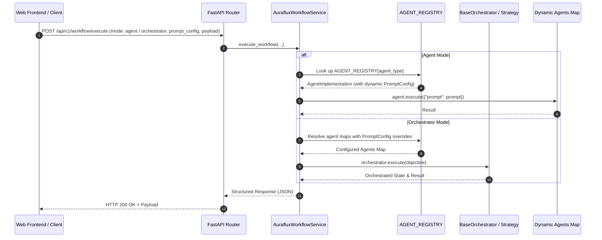

# Backend Integration Tutorial: Sharing Agents & Orchestrators in Web Services

This tutorial guides backend developers on how to cleanly integrate, share, and invoke `Auraflux-Core` **Agents** (via [`src/auraflux_core/agents.py`](../../src/auraflux_core/agents.py) registry and `agent.execute(...)`) and **Orchestrators** (via [`BaseOrchestrator`](../../src/auraflux_core/core/orchestrators/base.py) and [`DualLayerAgenticStrategy`](../../src/auraflux_core/core/orchestrators/strategies/dual_layer_strategy.py)) inside production backend web frameworks (such as FastAPI, Django, or Flask).

---

## 🏗️ 1. Architecture & Design Principles

When embedding Auraflux inside an enterprise backend, adhere to the following architectural best practices:

1. **Centralized Agent Registry (`AGENT_REGISTRY`)**: Use the high-level agent registry exposed in [`src/auraflux_core/agents.py`](../../src/auraflux_core/agents.py) to instantiate pre-configured agents (e.g., `MentalModelAgent`, `ExtractKeywordsAgent`, or `GenericAgent`) dynamically, and execute them via `await agent.execute(payload)`.
2. **Orchestrator & Strategy Pattern**: Use [`BaseOrchestrator`](../../src/auraflux_core/core/orchestrators/base.py) combined with orchestration strategies like [`DualLayerAgenticStrategy`](../../src/auraflux_core/core/orchestrators/strategies/dual_layer_strategy.py), injecting dynamically resolved `agents` and `tools` dictionaries, and execute workflows via `await orchestrator.execute(input_data)`.
3. **Singleton Client & FastAPI Lifespan Management**: Initialize [`ClientManager`](../../src/auraflux_core/core/clients/client_manager.py) and configuration settings using FastAPI's application `lifespan` event handler to manage connection pooling, graceful startup, and teardown, avoiding re-instantiating LLM providers on every request.
4. **Dynamic Model & Configuration Routing**: Support multi-tenancy and runtime model switching by passing `provider` and `model_id` parameters through request payloads to dynamically resolve handlers via `ClientManager`.
5. **Dynamic PromptConfig & Agent Overrides**: Support runtime injection and overriding of `PromptConfig`, temperature, and system prompts through request payloads.
6. **Service Layer Abstraction**: Encapsulate Agent and Orchestrator execution logic within dedicated Service classes (e.g., `AurafluxWorkflowService`) so that API controllers remain thin and testable.
7. **Asynchronous Execution (`async/await`)**: Leverage Python's asynchronous model for non-blocking LLM inference and tool execution.

---

## 📐 2. System Architecture Diagram



---

## 💻 3. Implementation Example (FastAPI Service Layer & Lifespan)

Below is a complete, production-ready example demonstrating how to wrap Auraflux Agents (`agent.execute(...)`) and Orchestrators (`orchestrator.execute(...)`) into a reusable service with FastAPI `lifespan` event management, dependency injection, dynamic model routing, and dynamic `PromptConfig` loading.

### Step 3.1: Create `app/services/auraflux_workflow_service.py`

```python
from typing import Dict, Any, Optional, List
from auraflux_core.core.configs.settings import AurafluxSettings
from auraflux_core.core.clients.client_manager import ClientManager
from auraflux_core.core.schemas.clients import ClientConfig, ProviderConfig
from auraflux_core.core.schemas.messages import PromptConfig
from auraflux_core.agents import AGENT_REGISTRY
from auraflux_core.core.orchestrators.base import BaseOrchestrator
from auraflux_core.core.orchestrators.strategies.dual_layer_strategy import DualLayerAgenticStrategy

class AurafluxWorkflowService:
    def __init__(self):
        # 1. Initialize settings & ClientManager
        self.settings = AurafluxSettings()
        client_config = ClientConfig(
            providers=[
                ProviderConfig(
                    id="openai",
                    type="OPENAI",
                    api_key=getattr(self.settings, "openai_api_key", None)
                ),
                ProviderConfig(
                    id="gemini",
                    type="GEMINI",
                    api_key=getattr(self.settings, "gemini_api_key", None)
                )
            ]
        )
        self.client_manager = ClientManager(client_config)

    async def initialize(self):
        """Asynchronously initialize the ClientManager handlers and connection pools."""
        await self.client_manager.initialize()

    async def close(self):
        """Gracefully close and cleanup resources."""
        pass

    def _get_client_handler(self, provider: str = "openai", model_id: str = "gpt-4o"):
        """Dynamically route and retrieve the appropriate client handler based on provider and model ID."""
        provider_config = ProviderConfig(provider=provider, model_id=model_id)
        return self.client_manager.get_handler(provider_config)

    def _build_agent(
        self,
        agent_type: str,
        client_handler: Any,
        system_prompt: Optional[str] = None,
        prompt_config: Optional[PromptConfig] = None,
        temperature: float = 0.7
    ):
        """Helper to instantiate an agent from AGENT_REGISTRY with dynamic PromptConfig and overrides."""
        agent_impl = AGENT_REGISTRY.get(agent_type) or AGENT_REGISTRY.get("default")

        config = agent_impl.config_class(
            name=agent_type,
            provider=client_handler.provider if hasattr(client_handler, "provider") else "openai",
            model=client_handler.model_id if hasattr(client_handler, "model_id") else "gpt-4o",
            system_prompt=system_prompt or f"You are a professional enterprise AI assistant for {agent_type}.",
            prompt_config=prompt_config,
            temperature=temperature,
            pipeline_name="direct"
        )
        return agent_impl.agent_class(config=config, client_handler=client_handler)

    async def execute_agent(
        self,
        agent_type: str,
        prompt: str,
        system_prompt: Optional[str] = None,
        prompt_config: Optional[PromptConfig] = None,
        temperature: float = 0.7,
        provider: str = "openai",
        model_id: str = "gpt-4o"
    ) -> Dict[str, Any]:
        """Execute an agent retrieved from AGENT_REGISTRY using dynamic model routing and PromptConfig."""
        client_handler = self._get_client_handler(provider=provider, model_id=model_id)
        agent = self._build_agent(
            agent_type=agent_type,
            client_handler=client_handler,
            system_prompt=system_prompt,
            prompt_config=prompt_config,
            temperature=temperature
        )

        payload = {"prompt": prompt}
        response = await agent.execute(payload)

        return {
            "status": "success",
            "execution_type": "agent",
            "agent_type": agent_type,
            "provider": provider,
            "model_id": model_id,
            "output": response
        }

    async def execute_orchestrator(
        self,
        objective: str,
        required_agent_types: Optional[List[str]] = None,
        prompt_config: Optional[PromptConfig] = None,
        temperature: float = 0.7,
        provider: str = "openai",
        model_id: str = "gpt-4o"
    ) -> Dict[str, Any]:
        """Execute a multi-step workflow using BaseOrchestrator & DualLayerAgenticStrategy with dynamic agent resolution & PromptConfig."""
        client_handler = self._get_client_handler(provider=provider, model_id=model_id)
        strategy = DualLayerAgenticStrategy(client_handler=client_handler)

        agents = {}
        agent_types_to_load = required_agent_types or ["default"]

        for a_type in agent_types_to_load:
            agents[a_type] = self._build_agent(
                agent_type=a_type,
                client_handler=client_handler,
                system_prompt=f"You are an orchestrator sub-agent specialized in {a_type}.",
                prompt_config=prompt_config,
                temperature=temperature
            )

        orchestrator = BaseOrchestrator(
            strategy=strategy,
            tools=[],
            agents=agents
        )

        result_state = await orchestrator.execute(input_data=objective)

        return {
            "status": "success",
            "execution_type": "orchestrator",
            "provider": provider,
            "model_id": model_id,
            "loaded_agents": list(agents_map.keys()),
            "state_status": str(result_state.status),
            "output": result_state.model_dump()
        }
```

### Step 3.2: Expose via FastAPI with Lifespan & PromptConfig (`app/main.py`)

```python
from contextlib import asynccontextmanager
from fastapi import FastAPI, APIRouter, HTTPException, Depends
from pydantic import BaseModel
from typing import Optional, List, Dict, Any
from auraflux_core.core.schemas.messages import PromptConfig
from services.auraflux_workflow_service import AurafluxWorkflowService

ml_service: Optional[AurafluxWorkflowService] = None

@asynccontextmanager
async def lifespan(app: FastAPI):
    global ml_service
    ml_service = AurafluxWorkflowService()
    await ml_service.initialize()
    yield
    if ml_service:
        await ml_service.close()

app = FastAPI(title="Auraflux Backend Service", lifespan=lifespan)
router = APIRouter(prefix="/workflow", tags=["Auraflux Workflow"])

class ExecutionRequest(BaseModel):
    execution_type: str = "agent" # "agent" or "orchestrator"
    agent_type: Optional[str] = "default"
    required_agent_types: Optional[List[str]] = None
    prompt: str
    system_prompt: Optional[str] = None
    prompt_config: Optional[PromptConfig] = None
    temperature: float = 0.7
    provider: str = "openai"
    model_id: str = "gpt-4o"

def get_auraflux_service() -> AurafluxWorkflowService:
    if ml_service is None:
        raise HTTPException(status_code=503, detail="Auraflux Workflow Service is not initialized.")
    return ml_service

@router.post("/execute")
async def execute_workflow_endpoint(
    req: ExecutionRequest,
    service: AurafluxWorkflowService = Depends(get_auraflux_service)
):
    try:
        if req.execution_type == "agent":
            result = await service.execute_agent(
                agent_type=req.agent_type,
                prompt=req.prompt,
                system_prompt=req.system_prompt,
                prompt_config=req.prompt_config,
                temperature=req.temperature,
                provider=req.provider,
                model_id=req.model_id
            )
        elif req.execution_type == "orchestrator":
            result = await service.execute_orchestrator(
                objective=req.prompt,
                required_agent_types=req.required_agent_types,
                prompt_config=req.prompt_config,
                temperature=req.temperature,
                provider=req.provider,
                model_id=req.model_id
            )
        else:
            raise HTTPException(status_code=400, detail=f"Invalid execution_type: {req.execution_type}")
        return result
    except Exception as e:
        raise HTTPException(status_code=500, detail=str(e))

app.include_router(router)
```

---

## 🛡️ 4. Best Practices & Production Checklist

1. **Centralized Registry Usage**: Always invoke agents through [`AGENT_REGISTRY`](../../src/auraflux_core/agents.py) and execute them via `await agent.execute(...)`.
2. **Dynamic Agent & PromptConfig Overrides**: Inject `PromptConfig` and runtime parameters dynamically via API request payloads using shared builder helpers.
3. **Environment Configuration**: Always load API keys (`OPENAI_API_KEY`, `GEMINI_API_KEY`) through secure environment variables rather than hardcoding.
4. **Lifespan Connection Pooling**: Utilize FastAPI `lifespan` handlers to initialize and teardown `ClientManager` instances once per application lifecycle, preventing connection exhaustion and authentication overhead.
5. **Dynamic Model Routing**: Pass `provider` and `model_id` in request payloads to leverage dynamic handler resolution via `ClientManager` for multi-tenant and multi-model architectures.
6. **Timeout & Concurrency**: Configure appropriate HTTP timeouts and leverage asynchronous methods for non-blocking execution.
