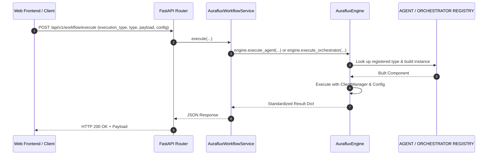

# Backend Integration Tutorial: Sharing Agents & Orchestrators in Web Services

This tutorial guides backend developers on how to cleanly integrate, share, and invoke [`AurafluxEngine`](../../src/auraflux_core/engine.py:11) inside production backend web frameworks (such as FastAPI, Django, or Flask), following the patterns outlined in [`engine-tutorial.md`](engine-tutorial.md).

---

## 🏗️ 1. Architecture & Design Principles

When embedding Auraflux inside an enterprise backend, adhere to the following architectural best practices:

1. **Centralized Engine Entry Point (`AurafluxEngine`)**: Use [`AurafluxEngine`](../../src/auraflux_core/engine.py:11) as the high-level facade to coordinate [`ClientManager`](../../src/auraflux_core/core/clients/client_manager.py), [`AGENT_REGISTRY`](../../src/auraflux_core/agents.py), and [`ORCHESTRATOR_REGISTRY`](../../src/auraflux_core/orchestrators.py).
2. **Defensive Initialization Guard**: Always await `engine.initialize()` during application startup and rely on `_ensure_initialized()` to block uninitialized executions.
3. **Singleton Lifecycle & FastAPI Lifespan Management**: Initialize [`AurafluxEngine`](../../src/auraflux_core/engine.py:11) using FastAPI's application `lifespan` event handler to manage connection pooling, graceful startup, and teardown, avoiding re-instantiating LLM providers on every request.
4. **Unified Execution Methods**: Execute registered agents via `await engine.execute_agent(agent_type, payload, config)` and orchestrators via `await engine.execute_orchestrator(orchestrator_type, payload, config)`.
5. **Service Layer Abstraction**: Encapsulate Engine invocation logic within dedicated Service classes (e.g., `AurafluxWorkflowService`) so that API controllers remain thin and testable.
6. **Asynchronous Execution (`async/await`)**: Leverage Python's asynchronous model for non-blocking LLM inference and tool execution.

---

## 📐 2. System Architecture Diagram



---

## 💻 3. Implementation Example (FastAPI Service Layer & Lifespan)

Below is a complete, production-ready example demonstrating how to wrap [`AurafluxEngine`](../../src/auraflux_core/engine.py:11) into a reusable service with FastAPI `lifespan` event management, dependency injection, and Pydantic configuration validation.

### Step 3.1: Create `app/services/auraflux_workflow_service.py`

```python
from typing import Dict, Any, Optional
from auraflux_core.engine import AurafluxEngine
from auraflux_core.core.schemas.engine import EngineConfig
from auraflux_core.core.schemas.clients import ClientConfig, ProviderConfig, ModelConfig
from auraflux_core.core.schemas.agents import AgentConfig
from auraflux_core.core.schemas.orchestrators import OrchestratorConfig
from auraflux_core.core.configs.settings import AurafluxSettings

class AurafluxWorkflowService:
    def __init__(self):
        self.settings = AurafluxSettings()

        # Configure ClientManager through EngineConfig
        provider_config = ProviderConfig(
            api_key=getattr(self.settings, "openai_api_key", "your-api-key")
        )
        client_config = ClientConfig(
            default_provider="openai",
            providers={"openai": provider_config},
            models={"gpt-4o": ModelConfig(id="gpt-4o", provider="openai")}
        )
        engine_config = EngineConfig(client_config=client_config)

        self.engine = AurafluxEngine(config=engine_config)

    async def initialize(self):
        """Asynchronously initialize the AurafluxEngine and underlying ClientManager."""
        await self.engine.initialize()

    async def close(self):
        """Gracefully close resources."""
        pass

    async def execute_agent(
        self,
        agent_type: str,
        payload: Dict[str, Any],
        config: Optional[AgentConfig] = None
    ) -> Dict[str, Any]:
        """Execute an agent via AurafluxEngine."""
        agent_config = config or AgentConfig(model="gpt-4o")
        return await self.engine.execute_agent(
            agent_type=agent_type,
            payload=payload,
            config=agent_config
        )

    async def execute_orchestrator(
        self,
        orchestrator_type: str,
        payload: Dict[str, Any],
        config: Optional[OrchestratorConfig] = None
    ) -> Dict[str, Any]:
        """Execute an orchestrator via AurafluxEngine."""
        orchestrator_config = config or OrchestratorConfig(timeout=60.0, max_retries=3)
        return await self.engine.execute_orchestrator(
            orchestrator_type=orchestrator_type,
            payload=payload,
            config=orchestrator_config
        )
```

### Step 3.2: Expose via FastAPI with Lifespan (`app/main.py`)

```python
from contextlib import asynccontextmanager
from fastapi import FastAPI, APIRouter, HTTPException, Depends
from pydantic import BaseModel
from typing import Optional, Dict, Any
from auraflux_core.core.schemas.agents import AgentConfig
from auraflux_core.core.schemas.orchestrators import OrchestratorConfig
from services.auraflux_workflow_service import AurafluxWorkflowService

workflow_service: Optional[AurafluxWorkflowService] = None

@asynccontextmanager
async def lifespan(app: FastAPI):
    global workflow_service
    workflow_service = AurafluxWorkflowService()
    await workflow_service.initialize()
    yield
    if workflow_service:
        await workflow_service.close()

app = FastAPI(title="Auraflux Engine Service", lifespan=lifespan)
router = APIRouter(prefix="/workflow", tags=["Auraflux Workflow"])

class ExecutionRequest(BaseModel):
    execution_type: str = "agent" # "agent" or "orchestrator"
    target_type: str = "basic_agent"
    payload: Dict[str, Any]
    agent_config: Optional[AgentConfig] = None
    orchestrator_config: Optional[OrchestratorConfig] = None

def get_workflow_service() -> AurafluxWorkflowService:
    if workflow_service is None or not workflow_service.engine.is_initialized:
        raise HTTPException(status_code=503, detail="Auraflux Engine is not initialized.")
    return workflow_service

@router.post("/execute")
async def execute_workflow_endpoint(
    req: ExecutionRequest,
    service: AurafluxWorkflowService = Depends(get_workflow_service)
):
    try:
        if req.execution_type == "agent":
            result = await service.execute_agent(
                agent_type=req.target_type,
                payload=req.payload,
                config=req.agent_config
            )
        elif req.execution_type == "orchestrator":
            result = await service.execute_orchestrator(
                orchestrator_type=req.target_type,
                payload=req.payload,
                config=req.orchestrator_config
            )
        else:
            raise HTTPException(status_code=400, detail=f"Invalid execution_type: {req.execution_type}")
        return result
    except Exception as e:
        raise HTTPException(status_code=500, detail=str(e))

app.include_router(router)
```

---

## 🛡️ 4. Best Practices & Production Checklist

1. **Engine Facade Pattern**: Always delegate execution requests through [`AurafluxEngine`](../../src/auraflux_core/engine.py:11) rather than directly instantiating low-level clients or strategies.
2. **Defensive Initialization**: Ensure `engine.initialize()` is awaited in your application lifespan handler before accepting traffic.
3. **Environment Configuration**: Securely load API keys and credentials via environment variables and [`AurafluxSettings`](../../src/auraflux_core/core/configs/settings.py).
4. **Pydantic Validation**: Utilize [`AgentConfig`](../../src/auraflux_core/core/schemas/agents.py) and [`OrchestratorConfig`](../../src/auraflux_core/core/schemas/orchestrators.py:15) to validate parameters such as timeouts, retries, and model parameters.
5. **Standardized Responses**: Rely on `AurafluxEngine`'s standardized response dictionaries (`status`, `result`/`final_state`, `metadata`) for consistent API error handling and status reporting.
