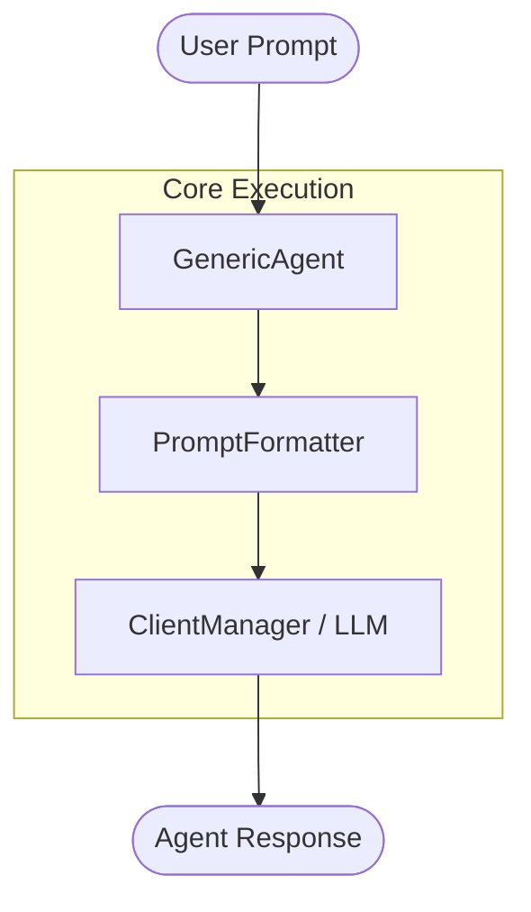

# Basic Agent Creation Tutorial (`basic-agent-tutorial.md`)

This tutorial demonstrates how to build a basic agent using [`GenericAgent`](src/auraflux_core/core/agents/generic_agent.py:8) and [`ClientManager`](src/auraflux_core/core/clients/client_manager.py:4) within the **Auraflux-Core** framework before progressing to advanced RAG scenarios.

---

## 1. Introduction

In **Auraflux-Core**, the foundational building block for AI interactions is [`BaseAgent`](src/auraflux_core/core/agents/base_agent.py) (or its versatile implementation [`GenericAgent`](src/auraflux_core/core/agents/generic_agent.py:8)). Understanding how to initialize a basic agent sets the stage for utilizing specialized extractors like [`ExtractKeywordsAgent`](src/auraflux_core/rag/agents/keywords_extractor.py:14).

---

## 2. Architecture Overview



---

## 3. Implementation Code

Below is a simple example showing how to configure and run a basic summarization/greeting agent.

```python
import asyncio
from auraflux_core.core.agents.generic_agent import GenericAgent
from auraflux_core.core.clients.client_manager import ClientManager
from auraflux_core.core.schemas.agents import AgentConfig
from auraflux_core.core.schemas.messages import PromptConfig, SystemPromptSpec

async def main():
    # 1. Initialize Client Manager
    client_manager = ClientManager()

    # 2. Define Agent Configuration with prompt_config (Best Practice)
    prompt_config = PromptConfig(
        system=SystemPromptSpec(
            templates={
                "default": "You are a helpful and concise assistant. Answer user requests directly."
            }
        )
    )

    config = AgentConfig(
        name="BasicAssistant",
        description="A simple assistant for basic text tasks.",
        model="gemini-flash-lite-latest",
        temperature=0.7,
        prompt_config=prompt_config
    )

    # 3. Instantiate GenericAgent
    agent = GenericAgent(
        config=config,
        client_manager=client_manager
    )

    # 4. Execute Agent with a Payload
    payload = {"input": "Explain what an AI agent is in one sentence."}
    result = await agent.execute(payload=payload)

    print("Agent Response:")
    print(result)

if __name__ == "__main__":
    asyncio.run(main())
```

---

## 4. Next Steps

Once you are comfortable with creating basic agents, you can proceed to the advanced RAG example:
- [`Orchestrator & ExtractKeywordsAgent Example`](manual/examples/rag/orchestrator-keywords-example.md)
