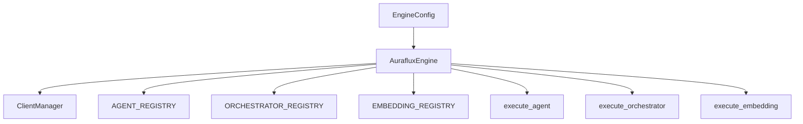

# Auraflux Engine Tutorial (`engine-tutorial.md`)

This tutorial introduces the core concepts, initialization workflow, and execution patterns of [`AurafluxEngine`](src/auraflux_core/engine.py:11) within the **Auraflux-Core** framework. The engine serves as the high-level entry point orchestrating LLM clients, agent registries, orchestrator registries, and embedding registries.

---

## 1. Core Architecture & Concepts

[`AurafluxEngine`](src/auraflux_core/engine.py:11) coordinates several internal components to provide a unified interface for executing agents, orchestrators, and embeddings:



Key responsibilities:
- **Lifecycle Management**: Ensuring safe initialization via [`initialize()`](src/auraflux_core/engine.py:32) and defensive checks via [`_ensure_initialized()`](src/auraflux_core/engine.py:59).
- **Client Management**: Initializing and wrapping [`ClientManager`](src/auraflux_core/core/clients/client_manager.py) using [`EngineConfig`](src/auraflux_core/core/schemas/engine.py).
- **Execution Dispatching**: Providing unified methods [`execute_agent`](src/auraflux_core/engine.py:79), [`execute_orchestrator`](src/auraflux_core/engine.py:122), and [`execute_embedding`](src/auraflux_core/engine.py:168) to run registered components.

---

## 2. Basic Initialization and Execution Example

Below is a complete example demonstrating how to configure, initialize, and execute agents, orchestrators, and embeddings using [`AurafluxEngine`](src/auraflux_core/engine.py:11):

```python
import asyncio
from auraflux_core.engine import AurafluxEngine
from auraflux_core.core.schemas.engine import EngineConfig
from auraflux_core.core.schemas.agents import AgentConfig
from auraflux_core.core.schemas.orchestrators import OrchestratorConfig
from auraflux_core.core.schemas.embeddings import EmbeddingConfig
from auraflux_core.core.schemas.clients import ClientConfig, ProviderConfig, ModelConfig

async def main():
    # 1. Prepare Client and Engine Configuration
    provider_config = ProviderConfig(api_key="your-api-key")
    client_config = ClientConfig(
        default_provider="gemini",
        providers={"gemini": provider_config},
        models={
            "gemini-flash": ModelConfig(id="gemini-flash", provider="gemini"),
            "text-embedding-004": ModelConfig(id="text-embedding-004", provider="gemini")
        }
    )
    engine_config = EngineConfig(
        client_config=client_config
    )

    # 2. Instantiate and Initialize the Engine
    engine = AurafluxEngine(config=engine_config)
    await engine.initialize()

    # 3. Execute a Registered Agent
    agent_config = AgentConfig(model="gemini-flash")
    agent_response = await engine.execute_agent(
        agent_type="basic_agent",
        payload={"prompt": "Hello, Auraflux!"},
        config=agent_config
    )
    print("Agent Execution Result:", agent_response)

    # 4. Execute a Registered Orchestrator with OrchestratorConfig
    orchestrator_config = OrchestratorConfig(
        timeout=60.0,
        max_retries=5
    )
    orchestrator_response = await engine.execute_orchestrator(
        orchestrator_type="dual_layer",
        payload={"task": "Coordinate multi-agent workflow"},
        config=orchestrator_config
    )
    print("Orchestrator Execution Result:", orchestrator_response)

    # 5. Execute Embedding Generation
    embedding_config = EmbeddingConfig(model="text-embedding-004")
    embedding_response = await engine.execute_embedding(
        embedding_type="generic_embedding",
        payload={"text": "Auraflux Core embedding vector test."},
        config=embedding_config
    )
    print("Embedding Execution Result:", embedding_response)

if __name__ == "__main__":
    asyncio.run(main())
```

---

## 3. Best Practices & Defensive Patterns

1. **Defensive Guard**: Always await `engine.initialize()` before invoking execution methods. Internal helper `_ensure_initialized()` will raise a `RuntimeError` if invoked prematurely.
2. **Exception Resilience**: [`execute_agent`](src/auraflux_core/engine.py:79), [`execute_orchestrator`](src/auraflux_core/engine.py:122), and [`execute_embedding`](src/auraflux_core/engine.py:168) capture exceptions gracefully, returning standardized dictionaries containing `status="failed"` and error details.
3. **Configuration Pydantic Models**: Leverage [`EngineConfig`](src/auraflux_core/core/schemas/engine.py), [`OrchestratorConfig`](src/auraflux_core/core/schemas/orchestrators.py:15), and [`EmbeddingConfig`](src/auraflux_core/core/schemas/embeddings.py) for robust configuration validation.
